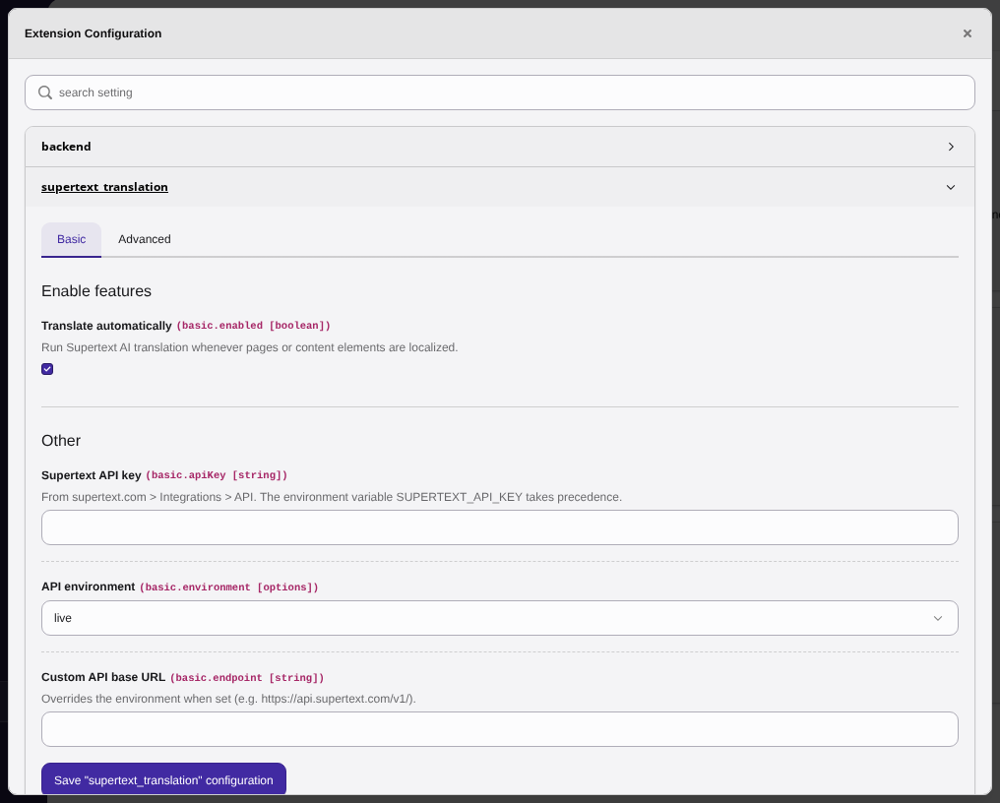
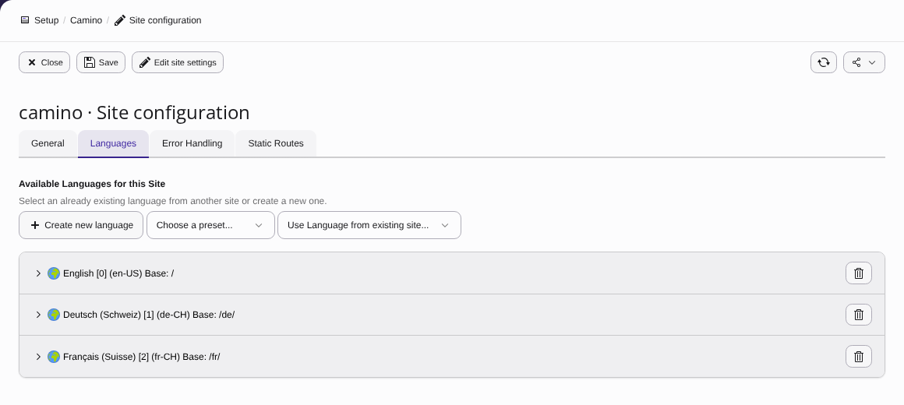

# Installation guide — Supertext Translation for TYPO3

For administrators setting up the extension on a TYPO3 site.

## Just want to try it?

A ready-to-run container with TYPO3 14.3, demo content in English, German and French, and this extension installed is in `demo/` (`docker build -f demo/Dockerfile .`). It is also what runs the public Supertext demo. See the *Demo* section of the [developer guide](DEVELOPER.md#demo-railway).

## Requirements

| | |
| --- | --- |
| TYPO3 | 14.3 LTS (tested), 13.4 LTS (supported, not yet tested) |
| PHP | 8.2 or newer, with `ext-dom` |
| Install mode | Composer-based TYPO3 (classic/non-Composer installs are not supported yet) |
| Supertext | An account with an API key — see [step 3](#3-set-the-api-key) |
| Network | The web server must reach `https://api.supertext.com` over HTTPS |

## 1. Add the package

The extension is not on Packagist yet. Install it from GitHub or from a local folder.

**From GitHub** — add the repository to your project's `composer.json`, then require it:

```bash
composer config repositories.supertext-typo3 vcs https://github.com/Supertext/Typo3-Supertext-Translation
composer require supertext/typo3-translation:dev-main
```

The extension brings the [Supertext SDK](https://github.com/Supertext/Supertext-API-SDK-and-Guide) it uses to talk to Supertext with it; there is nothing else to install.

The repository is private for now, so Composer needs a GitHub token with read access (`composer config --global github-oauth.github.com <token>`).

**From a local folder** — the TYPO3 base distribution already reads packages from `packages/*`:

```bash
# copy or clone the repo to packages/supertext_translation, then
composer require supertext/typo3-translation:@dev
```

## 2. Activate it

```bash
vendor/bin/typo3 extension:setup -e supertext_translation
vendor/bin/typo3 cache:flush
```

## 3. Set the API key

**Get a key first:**

1. No Supertext account yet? [Log in or create a Supertext account](https://www.supertext.com/person/en/account/signin) with your e-mail address.
2. Generate your API key at [supertext.com → Integrations → API](https://www.supertext.com/en/integrations/api). This needs the **Admin** role in your Supertext account; if you don't have it, ask your account's admin to create the key.

**Then enter it** — either:

- **Backend:** *System → Settings → Extension Configuration → supertext_translation* (TYPO3 13: *Admin Tools → Settings*) → paste the key into *Supertext API key*, or
- **Environment variable:** `SUPERTEXT_API_KEY=...` (takes precedence over the backend setting — recommended for servers, as the key then stays out of the database and `config/system/settings.php`).

The key can be entered as Supertext shows it (`Supertext-Auth-Key …`) or without that prefix; both work.

TYPO3 asks you to confirm your password before opening *Settings*, and only system maintainers can open it.

The extension checks the key automatically (see [Version information and the API key check](#version-information-and-the-api-key-check)): the next time you open the extension configuration after saving it, the **Status** block at the top shows the result with its time — *the connection to Supertext works*, *Supertext rejected the API key* or *no API key is set* (both with the links to create a Supertext account and to generate a key at supertext.com → Integrations → API), or *Supertext can't be reached*. TYPO3 has no hook for "configuration saved", so the check runs when the configuration is opened again or when the next translation runs, not at the moment you click *Save*.



### Interface languages

The extension's own texts (the settings in the extension configuration and the success and warning messages after a translation) are available in English, German, French and Italian. They follow each backend user's interface language: *User settings* (user menu → *User Settings*) → *Personal data* → *Language*. The language pack for that language must be installed (*Maintenance → Manage Language Packs*), otherwise TYPO3 shows English. Other languages fall back to English.

## 4. Configure the site languages

Every site language needs a **Supertext language**. Supertext accepts exactly its own codes (table below), and the extension never guesses one: whether a site's `de` means Germany or Switzerland is your decision.

- **Automatic:** a site language whose locale (without encoding) already is a Supertext code is used as it is, apart from case and `_`/`-`: `de_CH.UTF-8` → `de-CH`, `fr_FR` → `fr-FR`, `es` → `es`, `nl` → `nl`.
- **Mapped:** for any other locale, choose the Supertext language in the site configuration: *Sites → Setup → edit the site → Languages → (language) → Supertext → Supertext language* (TYPO3 13: *Site Management → Sites*). The list offers every Supertext language with its name and code. Or set `supertext_code` in `config/sites/<site>/config.yaml`. Typical cases: `de` → `de-DE` or `de-CH`, `en` → `en-US` or `en-GB`, `es_ES` → `es`, `nl_NL` → `nl`, `zh_CN` → `zh-Hans`, `nb_NO` → `nb`.
- **Not mapped:** a translation into a language that has neither stops before anything is sent to Supertext, with the message *The language … has no Supertext language yet* (the records are still localized as copies). The **Status** block in the extension configuration lists every site language with the Supertext code it is sent as and marks the ones that aren't mapped.

The default language is the **source**. It is sent as a bare language: its `supertext_code` or locale reduced to the language (`en_US.UTF-8` → `en`, `de-CH` → `de`).

Earlier versions of this extension gave locales without region a default region (`de` → `de-DE`, `es` → `es-ES`). Supertext rejects several of those (`es-ES`, `sl-SI`, `zh-CN`), so that is gone: after updating, check the **Status** block and map the languages it marks as *Not mapped*.



The per-language keys, in the form or directly in the YAML:

```yaml
languages:
  -
    languageId: 1
    locale: de_CH.UTF-8
    supertext_code: de-CH          # Supertext language (sent as it is); empty = automatic
    supertext_politeness: more     # more = formal (Sie/vous/Lei), less = informal (du/tu); empty = default
```

A `supertext_code` that isn't in the list below is sent as it is, so a language Supertext adds later works before the extension knows it (the form's list only offers the known ones; set it in the YAML).

**Tone:** formal or informal address exists only for some languages (column *Tone* below). For the others, leave *Supertext tone* at *Default*; otherwise Supertext refuses the translation (*Supertext offers no formal or informal tone for this language*) and the Status block marks the language.

### Supertext languages

As offered by the Supertext API in October 2026. Targets:

| Code | Language | Tone |
| --- | --- | --- |
| `bg` | Bulgarian | ✓ |
| `cs` | Czech | ✓ |
| `da` | Danish | ✓ |
| `de-AT` | German (Austria) | ✓ |
| `de-CH` | German (Switzerland) | ✓ |
| `de-DE` | German (Germany) | ✓ |
| `el` | Greek | ✓ |
| `en-GB` | English (United Kingdom) | – |
| `en-US` | English (United States) | – |
| `es` | Spanish | ✓ |
| `fi` | Finnish | ✓ |
| `fr-CH` | French (Switzerland) | ✓ |
| `fr-FR` | French (France) | ✓ |
| `gsw-u-sd-chbe` | Swiss German (Bern) | – |
| `gsw-u-sd-chzh` | Swiss German (Zurich) | – |
| `hr` | Croatian | ✓ |
| `hu` | Hungarian | ✓ |
| `it-CH` | Italian (Switzerland) | ✓ |
| `it-IT` | Italian (Italy) | ✓ |
| `ja` | Japanese | ✓ |
| `ko` | Korean | ✓ |
| `nb` | Norwegian Bokmål | ✓ |
| `nl` | Dutch | ✓ |
| `pl` | Polish | ✓ |
| `pt-BR` | Portuguese (Brazil) | ✓ |
| `pt-PT` | Portuguese (Portugal) | ✓ |
| `rm` | Romansh | – |
| `ru` | Russian | ✓ |
| `sk` | Slovak | ✓ |
| `sl` | Slovenian | ✓ |
| `sq` | Albanian | – |
| `sr-Cyrl` | Serbian (Cyrillic) | – |
| `sr-Latn` | Serbian (Latin) | – |
| `sv` | Swedish | ✓ |
| `tr` | Turkish | ✓ |
| `zh-Hans` | Chinese (Simplified) | ✓ |
| `zh-Hant` | Chinese (Traditional) | ✓ |

Sources (the default language): `bg`, `cs`, `da`, `de`, `el`, `en`, `es`, `fi`, `fr`, `gsw`, `hr`, `hu`, `it`, `ja`, `ko`, `nb`, `nl`, `pl`, `pt`, `rm`, `ru`, `sk`, `sl`, `sq`, `sr`, `sv`, `tr`, `zh`.

Supertext doesn't offer Arabic, Estonian, Latvian, Lithuanian, Romanian, Thai, Ukrainian or Vietnamese.

## 5. Check it works

Localize a page in the Page module (language menu → *Create new translation*, see the [user guide](USER_GUIDE.md#translate-a-page)). After the wizard finishes you should see a green "Supertext translated N field(s)…" message. Or from the CLI:

```bash
vendor/bin/typo3 supertext:localize <page-uid> <language-id>
```

## All settings

| Setting | Default | Purpose |
| --- | --- | --- |
| `enabled` | on | Translate automatically on localization |
| `apiKey` | – | Supertext API key, with or without the `Supertext-Auth-Key ` prefix (`SUPERTEXT_API_KEY` wins) |
| `environment` | live | `live`, `staging` or `testing` API |
| `endpoint` | – | Custom base URL (`SUPERTEXT_API_ENDPOINT` wins) |
| `pollTimeout` | 180 s | Maximum wait per translation |
| `pollInterval` | 2 s | Time between status checks |
| `skipBodytextCTypes` | `html` | Content types whose bodytext is code and must not be translated |
| `regenerateSlugs` | on | Build translated page URLs from translated titles |
| `versionReports` | on | *Send version information to Supertext* (see below); `SUPERTEXT_VERSION_REPORTS` wins |
| *Status* | – | Not a setting: the latest API key check, whether version information is sent (with the ping address), and every site language with its Supertext code |

Per site language (site configuration, see [step 4](#4-configure-the-site-languages)):

| Key | Default | Purpose |
| --- | --- | --- |
| `supertext_code` | automatic | Supertext language of this site language (the default language: its source). Empty = the locale, if it is a Supertext code |
| `supertext_politeness` | default | `more` (formal) or `less` (informal), only for languages that offer it |

Environment variables:

| Variable | Purpose |
| --- | --- |
| `SUPERTEXT_API_KEY` | API key; wins over the setting |
| `SUPERTEXT_API_ENDPOINT` | API base URL; wins over `environment` and `endpoint` |
| `SUPERTEXT_VERSION_REPORTS` | `0` (or `false`, `off`, `no`) turns version information off, `1` (`true`, `on`, `yes`) on; wins over `versionReports` |

## Version information and the API key check

**Send version information to Supertext** (`versionReports`) is on by default. The extension then sends the site URL and the versions of this extension, TYPO3 and PHP to Supertext when the configuration was saved and after an update, so Supertext support can see which version you run. A report contains exactly:

- the site URL: the base of the first site with an absolute base URL (e.g. `https://www.example.ch/`), else the address the backend runs on,
- the extension's name (`Typo3-Supertext-Translation`) and version, the TYPO3 and PHP versions, the version of the bundled Supertext SDK,
- whether an API key is set, and the result of the API key check below (status, time, HTTP status, Supertext's error code),
- the address of the ping endpoint (below).

**No content, no API key and no personal data are sent.** Reports go from the TYPO3 server (never from the browser) after the backend request has been answered, with a 3-second timeout; a report that fails is not retried for an hour and never slows down or breaks a save or a translation. To turn it off, untick the setting, or set `SUPERTEXT_VERSION_REPORTS=0` in the server's environment (wins over the setting): nothing is sent at all then, and the ping endpoint answers 404. The Status block shows *On*, *Off* or *Off (environment variable SUPERTEXT_VERSION_REPORTS)*.

**When:** after the configuration was saved (noticed the next time the configuration is opened or a translation runs: `settings_saved`, or `installed` the first time), and on backend requests that run the extension — opening its configuration, a translation, `supertext:localize` — when TYPO3, PHP or the extension was updated since the last report (`upgraded`) or the key check result changed (`api_key_check`). Front-end page views never report.

**The API key check** runs whether or not version information is sent: after the configuration was saved, when the key (for example from `SUPERTEXT_API_KEY`) changed since the last check, and when Supertext rejects the key during a translation. It is Supertext's cost-free `features` call; nothing is translated or billed. The Status block shows the latest result with its time.

**The ping endpoint** `GET <TYPO3 root URL>/supertext/ping?challenge=…` (e.g. `https://www.example.ch/supertext/ping`) is public (no login, no session, no page cache) and answers only `{"ok":true,"plugin":"Typo3-Supertext-Translation","challenge":"…"}`, so Supertext can see that the site is reachable from the internet. It returns nothing else: no versions, no settings, no data. A proxy, firewall or basic-auth protection in front of TYPO3 may block it; that only means Supertext sees the site as not reachable.

**Stored locally:** what was reported last, the time of a failed report and the latest key check (with a fingerprint of the key, never the key) in TYPO3's registry (table `sys_registry`, namespace `supertext_translation`), plus a fingerprint of the extension configuration to notice saves.

## Updating

```bash
composer update supertext/typo3-translation
vendor/bin/typo3 extension:setup -e supertext_translation
vendor/bin/typo3 cache:flush
```

## Uninstalling

```bash
composer remove supertext/typo3-translation
vendor/bin/typo3 cache:flush
```

Existing translations stay untouched; only automatic translation stops.

## Troubleshooting

| Message | Cause / fix |
| --- | --- |
| *Too many requests to Supertext* | The API's per-second limit was still exceeded after 4 automatic retries. Wait a moment and translate again. |
| *No Supertext API key configured* | Set the key (step 3); generate one at [supertext.com → Integrations → API](https://www.supertext.com/en/integrations/api). Records were still localized as plain copies. |
| *Authentication failed* | The key is wrong or revoked. Check it, or generate a new one at [supertext.com → Integrations → API](https://www.supertext.com/en/integrations/api) (Admin role required). |
| *has no site language N* | The page isn't inside a site, or the language isn't defined in that site's configuration. |
| *The language … has no Supertext language yet* | The site language's locale isn't a Supertext code and no Supertext language is chosen for it. Choose one (step 4); nothing was sent to Supertext. |
| *Supertext offers no formal or informal tone for this language* | `supertext_politeness` is set for a language without formal/informal (e.g. `en-US`, `rm`, `sq`, Serbian, Swiss German). Set *Supertext tone* to *Default*. |
| *Supertext rejected the API key* (Status block) | The key is wrong, incomplete or revoked. Copy the whole key again, or generate a new one at [supertext.com → Integrations → API](https://www.supertext.com/en/integrations/api) (Admin role required). No account yet? [Create one at supertext.com](https://www.supertext.com/person/en/account/signin). |
| *The API key couldn't be checked* (Status block) | Supertext couldn't be reached, or answered with an error (HTTP status in brackets). The settings are saved; open the configuration again later. |
| *Not checked yet* (Status block) | Save the configuration once and open it again, or run a translation. |
| *Timed out waiting* | Very large pages; raise `pollTimeout` (and PHP's `max_execution_time`). |
| *Supertext does not support this language pair* | Supertext rejected the source/target combination. Check the Supertext language (`supertext_code`) of the target language and of the default language against the [list](#supertext-languages). |
| *The translation from Supertext was empty or incomplete* | Supertext answered without some of the texts. Translate again; if it persists, contact Supertext support with the log entry. |
| *Could not reach Supertext* | The server can't make outbound HTTPS calls; check firewall/proxy (`$GLOBALS['TYPO3_CONF_VARS']['HTTP']['proxy']`). |

Errors are also written to the TYPO3 log (`var/log/typo3_*.log`).

## Security note for Composer installs

The web server's document root must point to the project's `public/` folder. If the whole project folder is web-accessible, files such as `composer.lock` and `config/` can be fetched from the internet.
