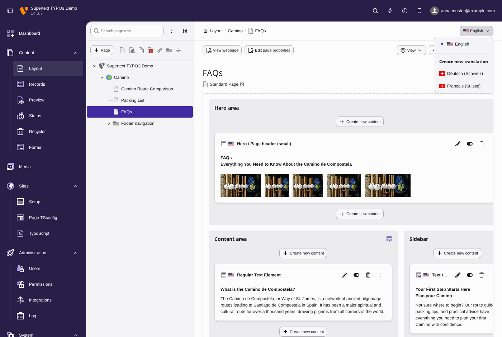
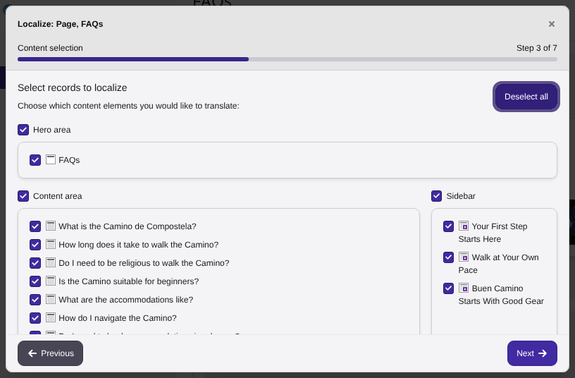
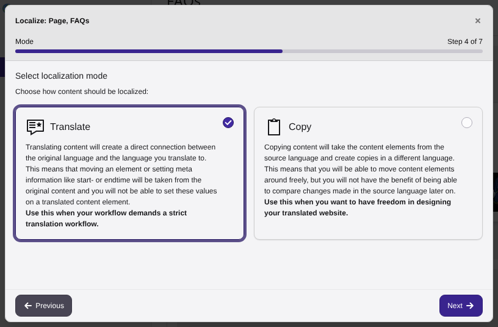
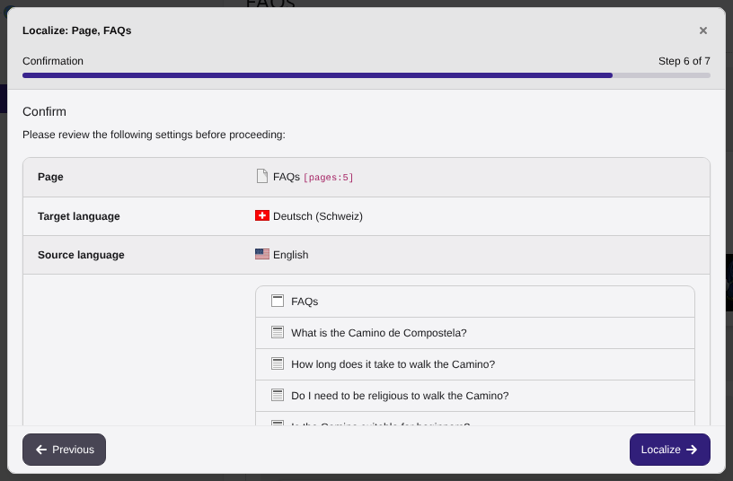
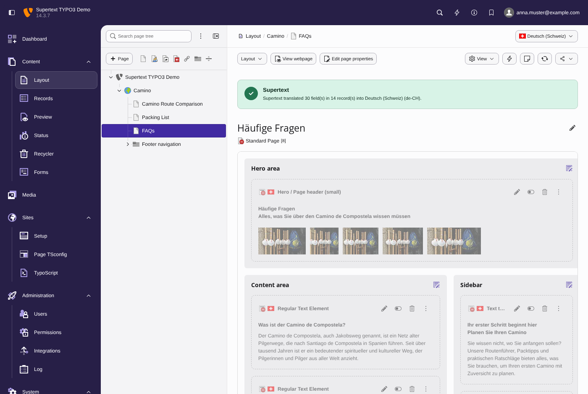
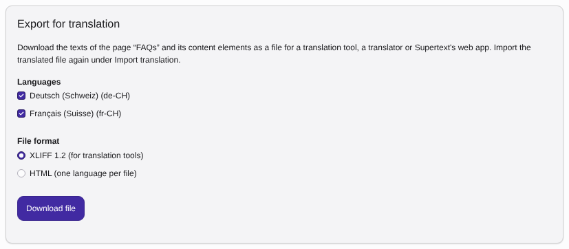
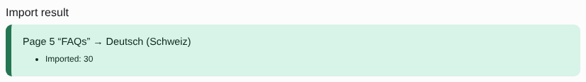

# User guide — Supertext Translation for TYPO3

For editors. Once an administrator has installed the extension (see [INSTALLATION.md](INSTALLATION.md)), you translate content exactly as you always do in TYPO3 — Supertext fills in the text automatically.

## Try it on the demo

The Supertext TYPO3 demo (ask Supertext for the address and a backend login) has a sample website in English with German and French set up as target languages. Translate any page as described below and open the German or French version of the site to see the result. Pages that aren't translated yet show the English text in the German and French versions.

## Translate a page

*Screenshots: TYPO3 14.3 with the Camino demo content.*

1. Open **Content → Layout** and select the page in the page tree.
2. Open the language menu at the top right (it shows the current language, e.g. *English*) and choose the target language under **Create new translation**.

   

3. TYPO3's **Localize** wizard opens. Choose the content elements to translate — all are selected by default — and click **Next**.

   

4. Choose how to localize:
   - **Translate** (connected mode): the translation stays linked to the original. The usual choice.
   - **Copy** (free mode): an independent copy you can restructure freely.

   

5. Check the summary and click **Localize**. Supertext translates the page and the selected elements in this step; it usually takes a few seconds. Then click **Finish**.

   

The page opens in the new language with a green message confirming what Supertext translated, for example *"Supertext translated 30 field(s) in 14 record(s) into Deutsch (Schweiz) (de-CH)."*



**TYPO3 13.4** has no wizard for the page itself: first use **Create new translation of this page**, then the **Translate** button in the language column, which offers the same Translate/Copy choice. Supertext translates in both steps.

## Translate content added later

When the page already exists in the target language, translate new or missing content elements from **Display mode → Language Comparison**: the target language column has a **Translate** button that opens the same Localize wizard (it also asks which language to translate from when the page has several). Supertext translates the elements you select.

## Review and publish

New translations are **hidden** — TYPO3's default — so nothing goes live unreviewed.

**Translation review:** if your administrator turned on *Translation review* for a language, reviewers (your colleagues or Supertext linguists) check and correct the translations on the website. Their corrections come into TYPO3 the next time content is translated into that language: after a review, delete the translation and translate it again. Texts reviewed once keep their corrected wording in later translations.

1. Read through the translated page and elements, correct anything you'd phrase differently.
2. Unhide the page translation and the content elements (eye icon) when you're happy.

## What gets translated

- Page title, navigation title, subtitle, SEO and social media texts, abstracts
- Content element headers, subheaders and text (formatting, links and lists are kept)
- Image and file captions, alt texts and titles
- Table content, row by row

The page's URL (slug) is rebuilt from the translated title, e.g. `/about-us` → `/de/ueber-uns`.

## What is *not* translated

- **HTML** content elements — the code is copied unchanged.
- Numbers, dates, e-mail addresses, links' targets, colours and other technical fields.
- Content that already has a translation in that language — translating twice never overwrites your edits.

## Translate with a file (XLIFF or HTML)

Instead of translating with Supertext AI right away, you can export a page as a file, have it translated elsewhere — in a translation tool (Trados, memoQ, Phrase …), by a translator, or by uploading it to Supertext's web app — and import the translated file again. Both happen in **Content → Supertext** (*Web → Supertext* in TYPO3 13). If you don't see it, ask your administrator to give your backend group access to the *Supertext* module.

**Export for translation**

1. Open **Content → Supertext** and select the page in the page tree.
2. Under *Export for translation*, tick the *Languages* to translate into.
3. Choose the *File format* and click **Download file**.



- **What's in the file:** the page's texts, its content elements and their image captions — exactly what Supertext translates when you localize the page. Only the languages you may edit are listed.
- **File format:** *XLIFF 1.2 (for translation tools)* — the better choice for translation tools, which protect the formatting; several languages go into one file — or *HTML (one language per file)*, which Supertext's web app and anyone who translates HTML can work with. HTML files must keep their head and the `data-st-id` attributes.
- A page with nothing to translate gives *Nothing to translate.* and no file.

**Import translation**

1. Open **Content → Supertext** (any page can be selected: the file says which page and language it belongs to).
2. Under *Import translation*, choose the *Translated file (XLIFF or HTML)*, at most 10 MB.
3. Tick *Also import texts whose source changed since the export* only if you want those too (see below), and click **Import**.

The translated texts go into the page's translation in that language. Records that aren't translated yet are created first, **hidden** like any new translation, so you can review them before publishing. Texts that are already translated are replaced by the file's. Files of at most 10 MB are accepted.

The *Import result* at the top of the screen shows a summary per page and language:



| Line | Meaning |
| --- | --- |
| *Imported* | Written into the translation. |
| *Skipped, source changed since the export* | Someone edited the English text after the export, so the translation may be out of date. Not written unless you tick *Also import texts whose source changed since the export*. |
| *Not translated in the file* | The translator left the text empty. |
| *Formatting changed, not imported* | The translation broke or added formatting (tags) that the original doesn't have. |
| *Not in the file* | Texts added to the page after the export. Export again to translate them. |

An HTML file imported unchanged writes the original text into the translation: HTML can't mark a text as untranslated, so only import HTML files that have been translated.

| Message | What it means |
| --- | --- |
| *This file isn't a valid XLIFF or HTML translation file.* | The file is damaged or isn't an XLIFF or HTML file. |
| *This file wasn't exported by the Supertext extension, or its header was removed.* | Use a file from *Export for translation*; in HTML files the head must stay as it was. |
| *This file belongs to another system (…).* | The file was exported by another Supertext plugin (e.g. from another CMS). |
| *The page this file was exported from no longer exists.* | The page was deleted after the export. |
| *The site has no language ….* | The target language was removed from the site after the export, or you may not edit that language. |
| *Choose at least one language.* / *An HTML file holds exactly one language. Choose one language, or XLIFF.* | Tick at least one language; for HTML exactly one. |
| *Select a page in the page tree to export it for translation.* | Click a page in the page tree first. |
| *The file is too large (at most 10 MB).* | Split the export into several pages. |

The import writes as you, so TYPO3's own permissions apply: records you may not edit are reported under the page with TYPO3's message and left unchanged.

**On the command line.** The same works without the backend, for scripts or large batches (run by whoever has access to the server):

```bash
vendor/bin/typo3 supertext:export 12 1            # page 12 into site language 1, XLIFF → typo3-12-de-CH.xlf
vendor/bin/typo3 supertext:export 12 1 2          # into two languages, one XLIFF file → typo3-12.xlf
vendor/bin/typo3 supertext:export 12 1 --format=html --output=faq-de.html   # HTML: one language per file
vendor/bin/typo3 supertext:import typo3-12-de-CH.xlf [--include-changed]
```

Page uid (default language) and site language ids as in *Sites → Setup*; the command prints the same summary.

## Formal and informal language

Your administrator can set each language to formal (*Sie/vous/Lei*) or informal (*du/tu*), for the languages where Supertext offers it (for example German, French and Italian, but not English). Ask them if the tone doesn't fit your site.

## When something goes wrong

The extension's messages appear in your backend interface language (English, German, French or Italian; set in your user settings).

If Supertext can't translate (no API key, network problem, quota reached), you'll see a yellow warning. The records are still created — as untranslated copies with TYPO3's usual *[Translate to …]* prefix — so you can translate by hand, or delete them and try again later. A missing or rejected API key is for your administrator to fix (see the [installation guide](INSTALLATION.md#3-set-the-api-key)).

Two messages are about the language settings, also for your administrator:

| Message | What it means |
| --- | --- |
| *Deutsch (Liechtenstein): The language de_LI has no Supertext language yet. Ask your administrator to choose one …* | Supertext only accepts its own language codes, this site language's locale has no obvious one (for example `de_LI` or `en_IE`), and nobody has chosen one for it yet. Nothing was sent to Supertext. Once your administrator has chosen the Supertext language, delete the untranslated copies and translate again. |
| *Supertext offers no formal or informal tone for this language …* | The language is set to formal or informal, but Supertext has no such choice for it (for example English). Your administrator sets its tone to *Default*. |

## Tips

- Translate a whole page at once rather than element by element: it's one request to Supertext and the context makes the translation more consistent.
- To retranslate an element, delete its translation and translate again.
